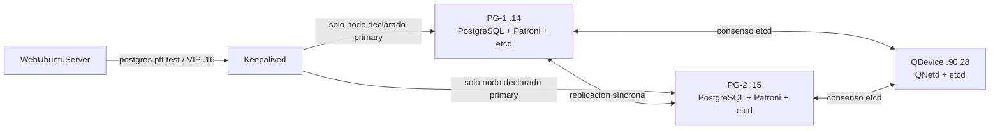

# Cambios acordados tras la conversación — Reestructuración HA

**Proyecto:** PFT-S1 / GNS3  
**Fecha:** 2026-08-29  
**Origen:** decisiones tomadas sobre `FODA_Y_CRITICA_PLANO_REESTRUCTURACION_HA.md` y `PLANO_EJECUTIVO_REESTRUCTURACION_HA.md`.

## 1. Decisión de alcance

El primer hito se concentrará en la continuidad de los servicios esenciales y en una demostración segura de failover automático de PostgreSQL.

| Componente | Decisión |
|---|---|
| Red y VLAN 50 `/27` | Permanece en alcance. |
| PVE-1, PVE-2 y QDevice | Permanece en alcance. |
| AD DS y DNS en dos DC | Permanece en alcance. |
| PostgreSQL HA | Permanece en alcance desde el primer hito, con failover automático. |
| Keepalived / VIP | Permanece en alcance por requisito universitario. |
| Zabbix | Permanece en alcance, limitado a PVE, AD/DNS y PostgreSQL HA. |
| WSUS | **Fuera de alcance.** No instalar ni configurar WSUS, réplica WSUS ni GPO de WSUS. |
| Réplica y arranque HA de VMs Proxmox | **Fuera de alcance.** No se implementarán jobs `pvesr` ni grupos HA de VMs en este hito. |
| Backup PostgreSQL, WAL/PITR y restauración | **Fuera de alcance académico.** |
| Redundancia DHCP | **Fuera de alcance.** DHCP se mantiene únicamente en CorevIOS-1. |
| Monitoreo de infraestructura de red | **Permanece en alcance.** SNMPv3 se configurará e inventariará en P7.2 para Core, distribución, acceso, Border, ISP y red intermedia que corresponda; luego Zabbix los monitoreará. Los end hosts quedan expresamente excluidos. |
| Prueba de red anidada PVE | **Compuerta bloqueante.** Antes de crear el clúster o desplegar servicios, una VM temporal dentro de cada PVE debe alcanzar gateway, la VM del otro PVE y las VLAN 90/100 a través de `vmbr0`. |
| Migración de aplicación, esquema y datos | **Fuera de alcance.** No se migran datos, no se modifican esquemas ni se exige rollback funcional de una aplicación existente. La validación usa una BD y cliente de prueba controlados. |
| TLS y certificados | **Fuera de alcance académico.** PostgreSQL, Patroni y etcd operan sin TLS dentro de la red aislada de GNS3; no es un patrón de producción. |
| Monitoreo del frontend | **Fuera de alcance.** El frontend es un end host y no se agrega a Zabbix ni se exige alerta propia. |
| Custodia y rotación de secretos | **Fuera de alcance.** Las claves se guardan manualmente fuera del proyecto; no se implementa vault, rotación ni procedimiento de custodia. |

### Estado de madurez del alcance

Las decisiones de este documento definen un diseño realizable para el hito académico, pero no sustituyen la evidencia de una implementación. Los puntos de capacidad, failover, ACL y objetivos de recuperación se consideran **amarillos** hasta que sus pruebas de aceptación se ejecuten y registren. El proyecto debe describirse como HA de servicios esenciales en un laboratorio, no como HA física integral.

### Baseline de versiones y dependencia externa

Se congela una imagen base antes de crear nodos: Proxmox VE **8.4.x** sobre Debian 12, Ubuntu Server **24.04.4 LTS**, PostgreSQL **16.15**, Patroni **4.0.10**, etcd **3.5.x** con el mismo parche en los tres miembros, Keepalived **2.2.8** del repositorio Ubuntu 24.04 y Zabbix **7.0 LTS**. Windows Server 2022 y Windows 10 Enterprise LTSC 2021 se usan para DC y clientes respectivamente. GNS3, Cisco vIOS y VirtIO no se actualizan durante el hito: se conserva la versión ya presente en el proyecto y se registra su versión exacta y el hash del ISO VirtIO seleccionado antes de construir. Sólo se permiten parches dentro de cada versión mayor antes de generar la imagen base; no se actualiza durante las pruebas de HA.

La recomendación única para repositorios, DNS externo y NTP es usar la **salida única ya existente por los Border Router con NAT**, validada antes de instalar paquetes desde un host temporal: debe llegar a repositorios oficiales HTTPS y NTP externo. Cuando AD DNS exista, los clientes usarán únicamente AD DNS, AD DNS reenviará al upstream accesible por esa salida y sólo el PDC consultará fuentes NTP externas. No se agregan resolvers, proxies ni rutas alternativas en este hito.

## 2. Arquitectura PostgreSQL acordada

Se reemplaza la propuesta de streaming replication + promoción desde Keepalived por una arquitectura donde la autoridad de promoción pertenece a Patroni.

### Cambios obligatorios

1. Instalar y configurar **Patroni** en PG-1 y PG-2.
2. Instalar un clúster **etcd de tres miembros**: uno en PG-1, uno en PG-2 y uno en la VM `PVE-QDEVICE` (`192.168.90.28`).
3. Mantener QDevice/QNetd para el quorum de Proxmox. El etcd adicional es independiente y sirve exclusivamente para el consenso de Patroni.
4. Configurar PostgreSQL con replicación **síncrona estricta**. El objetivo es RPO 0: una escritura solo se confirma cuando la réplica sana la recibió.
5. Configurar Patroni para que administre el primario, la promoción y la reincorporación de un nodo, en lugar de scripts `pg_isready` o `pg_ctl promote` ejecutados por Keepalived.
6. Mantener **Keepalived** para la VIP `192.168.50.16`, pero modificar su comprobación para consultar la API de Patroni y anunciar la VIP únicamente en el nodo que Patroni declara `primary`.
7. Eliminar los scripts de promoción de PostgreSQL desde Keepalived (`notify_master` / `promote_pg.sh`). Keepalived publica el endpoint; no decide quién puede escribir.
8. Mantener `postgres.pft.test` apuntando a la VIP `.16`; el frontend no debe conectarse directamente a `.14` ni `.15`.

### Semántica esperada

- Ante la caída de PG-1 o de PVE-1, PG-2 y el etcd del QDevice conservan mayoría; Patroni promueve PG-2 y Keepalived publica la VIP allí.
- Ante la caída de PG-2, PG-1 deja de confirmar escrituras mientras no exista una réplica síncrona sana. Se prioriza la consistencia sobre la disponibilidad de escritura.
- Ante una partición entre PG-1 y PG-2, la decisión de liderazgo se toma con quorum etcd. La prueba debe demostrar que no existen dos primarios que acepten escrituras.
- El QDevice y el tercer etcd ofrecen un tercer voto **lógico**. Como todos los componentes dependen del mismo host GNS3, no proporcionan resiliencia ante la caída de ese host físico.

### Semántica ante caída de la réplica

Si falla PG-2 mientras PG-1 es el `primary`, PG-1 y el etcd del QDevice conservan mayoría. Patroni mantiene a PG-1 como `primary` y Keepalived conserva la VIP `.16` en ese nodo; no corresponde promoción ni movimiento de VIP. Sin embargo, al exigirse replicación síncrona estricta, PG-1 deja de confirmar nuevas escrituras hasta que PG-2 vuelva como réplica sana. Las lecturas pueden continuar. Se prioriza RPO 0 sobre disponibilidad de escritura.

Si PG-1 cae siendo `primary`, PG-2 y el QDevice conservan mayoría, Patroni promueve PG-2 y Keepalived publica la VIP allí. Cuando vuelve el antiguo primario, Patroni debe reincorporarlo como réplica; nunca se realizará failback automático.

## 3. Objetivos y pruebas de aceptación

| Objetivo | Criterio acordado |
|---|---|
| RPO de PostgreSQL | **0** para transacciones confirmadas, mediante replicación síncrona. |
| RTO de PostgreSQL | **≤ 60 segundos** desde la caída del primario hasta que la aplicación pueda volver a escribir mediante la VIP. |
| Prueba de caída | Apagar o aislar PG-1/PVE-1; verificar promoción automática de PG-2, movimiento de VIP y escritura de la aplicación dentro del RTO. |
| Prueba de partición | Aislar el enlace entre PG-1 y PG-2; verificar que nunca haya dos nodos `primary` ni dos nodos aceptando escrituras. |
| Reintegración | Reincorporar el antiguo primario como réplica gestionada por Patroni; no hacer failback automático. |
| AD/DNS | Con un PVE caído, el DC que permanece debe seguir resolviendo DNS y atendiendo autenticación/dominio. |
| Zabbix | Debe mostrar disponibilidad y estado de PVE, AD/DNS, Patroni/PostgreSQL, réplica, VIP e infraestructura de red mediante SNMPv3. Los end hosts no se monitorean. |

Para pasar la arquitectura PostgreSQL de diseño a evidencia demostrada, se deben registrar estas cuatro pruebas: (1) caída total de PG-1 con failover y CRUD vía VIP dentro del RTO; (2) partición de PG-1 respecto de PG-2 y QDevice, verificando que PG-1 no acepte escrituras ni existan dos `primary`; (3) caída de PG-2, verificando que PG-1 mantiene liderazgo pero bloquea escrituras; y (4) reincorporación del nodo recuperado como réplica sin failback automático.

## 4. Capacidad y disponibilidad de plataforma

La disponibilidad del hito se evalúa a nivel de servicio, no mediante reinicio automático de VMs desde almacenamiento replicado de Proxmox.

- No configurar ZFS replication, `pvesr` ni recursos HA de Proxmox para las VMs.
- No dimensionar los discos PVE para alojar réplicas completas de las VMs del otro nodo.
- Al caer PVE-1, continúan DC2/DNS y PG-2; al caer PVE-2, continúan DC1/DNS y PG-1.
- Zabbix se ubicará en PVE-2 y se declara **no HA**. Durante una caída de PVE-2 puede perderse temporalmente la observabilidad, sin afectar la continuidad de AD/DNS o PostgreSQL.
- DHCP se mantiene exclusivamente en CorevIOS-1 y queda documentado como **SPOF aceptado**.

### Presupuesto de capacidad y ventana de prueba integrada

El host físico dispone de **30 GB de RAM**, **150 GB de disco real** y un **Intel Core i7 de 11.ª generación**. No se encenderá toda la topología a la vez: los nodos se iniciarán por fases. La capacidad se evalúa contra la ventana crítica integrada: ambos PVE, PG-1/PG-2, QDevice, Windows Client, Web Server, CorevIOS-1/2 y los switches intermedios imprescindibles para realizar CRUD desde el cliente hacia la aplicación y la base de datos.

| Capa o componente simultáneo | RAM máxima de planificación |
|---|---:|
| Ubuntu host, escritorio y servicios base | 3–4 GB |
| GNS3, procesos auxiliares y sobrecarga QEMU | 1–2 GB |
| PVE-1, incluidas sus VMs internas | 6 GB |
| PVE-2, incluidas sus VMs internas | 6 GB |
| QDevice + etcd | 0,5 GB |
| Windows Client | 2 GB |
| Web Server | 1–2 GB |
| CorevIOS, distribución e intermedios imprescindibles | 2–3 GB |
| Margen anti-saturación | 3 GB |
| **Total estimado** | **24,5–28,5 GB** |

La RAM de las VMs alojadas dentro de cada PVE está contenida en la asignación del PVE; no se debe sobreasignar memoria dentro de Proxmox. Zabbix y nodos no esenciales deben permanecer apagados durante esta prueba. En disco, se evitarán snapshots prolongados o múltiples y se mantendrán al menos 30 GB libres en el host. Este presupuesto es viable pero ajustado; se considera validado únicamente si una prueba integrada de 10–15 minutos no usa swap, mantiene 2–3 GB libres de manera sostenida y completa CRUD/failover sin pérdida de respuesta atribuible a saturación.

## 5. ACLs y segmentación

La única fuente normativa para diseño, configuración, sustitución, validación y rollback de ACL es `ACL_MATRIZ_Y_RUNBOOK.md`. Este documento sólo fija decisiones de alcance; no redefine ni simplifica las reglas del runbook.

| Origen | Destino | Política acordada |
|---|---|---|
| Todas las VLAN | Política aplicable | Usar exclusivamente la matriz y las ACL `PFT_*` definidas en `ACL_MATRIZ_Y_RUNBOOK.md`; no introducir permisos genéricos ni reglas alternativas desde este documento. |

Las ACL deben modificarse creando una política nueva, validándola y luego sustituyendo la referencia en la SVI, para evitar una ventana de filtrado inconsistente.

Los Windows Client del hito se ubican en **VLAN 90 (MGMT)**. Por tanto, son hosts de administración y no representan el acceso de usuarios de VLAN 10/20/30/40. Desde ellos se debe validar DNS contra DC1/DC2, unión e inicio de sesión de dominio, aplicación de GPO, acceso a la Web App y CRUD mediante `postgres.pft.test`, además de SSH/GUI de PVE para cuentas autorizadas. La denegación de administración PVE no aplica a estos clientes, pero sí a las demás VLAN internas. Se deben comprobar también el bloqueo de Guests hacia VLAN 50/90 y de DMZ hacia VLAN 50/90, salvo excepciones justificadas. Las pruebas desde VLAN 10/20/30/40 quedan fuera del hito salvo que se incorporen hosts representativos posteriormente.

Las ACL se consideran diseño hasta completar el inventario exigido por el runbook, sustituir todos los marcadores y registrar las pruebas positivas y negativas en evidencia de ejecución.

## 6. Objetivos de continuidad por servicio

La disponibilidad no se promete de la misma manera para todos los componentes. Esta matriz evita presentar un SPOF aceptado o una recuperación manual como HA automática.

| Servicio | RPO | RTO / comportamiento ante falla |
|---|---|---|
| PostgreSQL | 0 para transacciones confirmadas | ≤ 60 s si cae el primario; si cae la única réplica, se suspenden escrituras hasta recuperarla. |
| Web App | Hereda RPO 0 de PostgreSQL | ≤ 60 s ante caída del primario de BD, siempre que Web Server continúe disponible. |
| AD/DNS | Sin pérdida esperada de cambios ya replicados; los cambios recientes aún no replicados no tienen RPO garantizado | El DC superviviente debe resolver DNS y autenticar; objetivo de recuperación percibida ≤ 60 s. |
| Clúster Proxmox | No aplica a datos de servicio | Conserva quorum si cae un PVE; las VMs del nodo caído no se reinician automáticamente. |
| DHCP en CorevIOS-1 | No aplica a datos de aplicación | Sin RTO comprometido: SPOF aceptado; nuevas concesiones o renovaciones pueden fallar hasta recuperar CorevIOS-1. |
| Zabbix | No aplica a los servicios monitorizados | Sin RTO comprometido: si cae PVE-2 se pierde observabilidad hasta su recuperación. |
| QDevice / etcd en QDevice | No aplica por sí mismo | Su caída reduce el margen de quorum; no debe causar doble promoción mientras PG-1 y PG-2 sigan comunicados. |
| Host físico GNS3 | No aplica | Sin RTO comprometido; su caída está fuera del alcance del hito. |

Los objetivos anteriores están resueltos a nivel de diseño, pero permanecen en estado amarillo hasta registrar las pruebas de PostgreSQL, AD/DNS, quorum y capacidad. La exclusión de backup/PITR limita la solución: no se debe afirmar protección integral de datos ni recuperación histórica.

## 7. Cambios puntuales al plano ejecutivo

1. Eliminar WSUS de resumen, topología, inventario de VMs, direccionamiento funcional, GPO, validaciones y pasos de implementación.
2. Cambiar los DC a roles **AD DS + DNS**, sin discos adicionales ni funciones WSUS.
3. Reemplazar toda referencia a promoción manual y `Keepalived -> pg_isready -> pg_ctl promote` por Patroni + etcd + Keepalived subordinado al estado de Patroni.
4. Agregar etcd al QDevice y reflejar su función dual: `corosync-qnetd` para PVE y tercer voto de DCS para Patroni.
5. Eliminar el requisito de replicación PVE y HA de VM; actualizar las notas de almacenamiento y criterios de aceptación para que no lo exijan.
6. Mantener la IP de VIP `192.168.50.16` y el nombre `postgres.pft.test`.
7. Configurar Zabbix para PVE, AD/DNS y PostgreSQL HA; durante P7.2 configurar SNMPv3 e incorporar infraestructura de red, excluyendo explícitamente todos los end hosts.
8. Referenciar `ACL_MATRIZ_Y_RUNBOOK.md` como única fuente normativa de ACL y conservar sus controles para Guests, DMZ y administración PVE.
9. Declarar explícitamente los SPOF y exclusiones aceptadas: host GNS3, DHCP en CorevIOS-1, Zabbix, restauración de base de datos y reinicio HA de VMs.

## 8. Riesgos aceptados y no cubiertos

- La caída total del host GNS3 derriba PVE, QDevice y el tercer miembro etcd; la solución no pretende tolerar ese evento físico.
- La falta de backup/PITR implica que un borrado accidental, una corrupción lógica o un error replicado no podrá revertirse dentro de este alcance.
- Zabbix no será accesible si falla PVE-2.
- DHCP puede no atender nuevas solicitudes o renovaciones si falla CorevIOS-1.
- Las VMs alojadas en un PVE perdido no se reinician automáticamente en el otro nodo.

Estos límites son aceptados para el objetivo académico y deben presentarse como tales, sin etiquetar la plataforma Proxmox ni el laboratorio completo como HA física integral.

## 9. Compuerta de evidencia y siguiente hito

Antes de avanzar al siguiente hito se debe implementar y registrar evidencia práctica de los requisitos vigentes. Como mínimo, la evidencia debe cubrir inventario de red y SNMPv3, aplicación y validación de ACL, capacidad, quorum PVE, AD/DNS, caída y partición de PostgreSQL, comportamiento de la VIP y reintegración sin failback automático.

La gestión documental inicial debe alcanzar madurez en dos artefactos: requisitos trazables y un TO-DO priorizado con operador, condición de cierre y evidencia esperada. Sólo después se delimitan los hitos de avance al 50 %, 75 % y 100 %.
