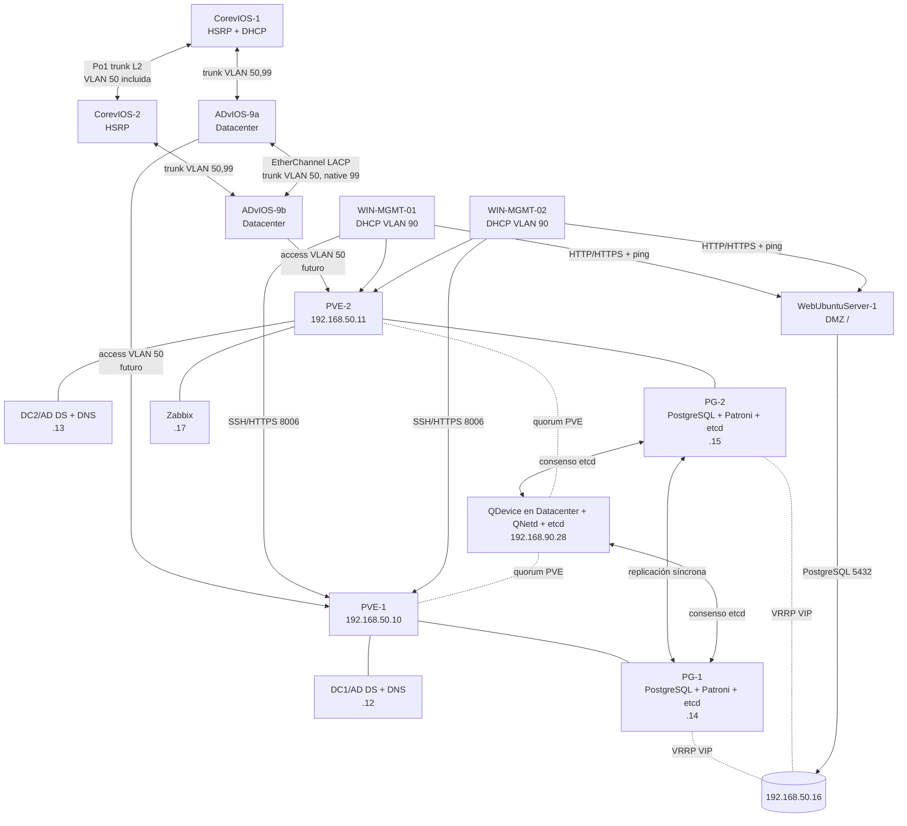

# Plano Ejecutivo — Reestructuración Datacenter, Proxmox y Servicios HA

**Proyecto:** PFT-S1 / GNS3 — Core, Distribución y Acceso  
**Fecha de diseño:** 2026-08-29  
**Alcance:** plan de implementación; no altera el proyecto GNS3, el libro de direccionamiento ni las configuraciones existentes.

**Hito académico:** continuidad de red VLAN 50 `/27`, PVE-1/PVE-2/QDevice, AD DS + DNS redundantes, PostgreSQL HA con failover automático, VIP, ACL IPv4 inter-VLAN por función y monitoreo limitado. Zabbix monitorea PVE, AD/DNS y PostgreSQL por agente, e infraestructura de red por SNMPv3; no monitorea end hosts, incluido el frontend. Quedan fuera WSUS, redundancia DHCP, backup/WAL/PITR/restauración de PostgreSQL, replicación/arranque HA de VMs Proxmox, migración de aplicación/esquema/datos, TLS/certificados y custodia o rotación de secretos. Los objetivos de capacidad, failover, ACL y RTO/RPO se consideran de diseño (estado amarillo) hasta registrar sus pruebas de aceptación. Esta solución es HA de servicios esenciales en laboratorio, no HA física integral ni un ambiente de producción.

## 1. Resumen ejecutivo

La topología actual mantiene dos Core vIOS con HSRP, Rapid-PVST, un Port-Channel L2 entre Core, OSPF hacia dos routers de borde, DHCP en `CorevIOS-1`, una VLAN de administración 90 y una VLAN de servidores 50. La VLAN 50 existente (`192.168.50.0/29`) solo dispone de seis direcciones utilizables; `.1`, `.2`, `.3` y la histórica `.6` figuran asignadas. Por ello no puede contener dos hosts Proxmox, dos controladores de dominio/DNS, dos servidores PostgreSQL, una VIP y Zabbix.

El cambio L3 mínimo viable es conservar **VLAN 50** y ampliar únicamente su prefijo a `192.168.50.0/27`. Se preservan el gateway HSRP `.1`, las direcciones físicas de Core `.2/.3`, todas las demás VLAN, OSPF y HSRP. La asignación histórica `.6` no se reutiliza hasta confirmarla en el inventario; el único frontend objetivo es `WebUbuntuServer-1` en DMZ/VLAN 100 y su IP estática debe confirmarse antes de cargar ACL.

La solución base reserva un par L2 dedicado de Datacenter, `ADvIOS-9a` y `ADvIOS-9b`: cada uno tendrá un uplink trunk hacia un Core y ambos se unirán mediante un EtherChannel LACP que transportará sólo VLAN 50 y 99 (nativa). PVE-1 y PVE-2 se conectarán posteriormente, uno a cada switch, como access VLAN 50. Este dominio no conecta ni transporta la DMZ/VLAN 100. Un tercer voto externo `QDevice` evita que el clúster de dos nodos pierda quorum. PostgreSQL usa Patroni con un DCS etcd de tres miembros y replicación síncrona estricta; Keepalived publica la VIP `192.168.50.16` solo en el nodo que Patroni declara `primary`. El único frontend en DMZ usa exclusivamente esa VIP.

> **Condición de aceptación:** dos nodos Proxmox sin QDevice no constituyen HA automática segura. Para PostgreSQL, Patroni —no Keepalived— es la única autoridad de promoción; el quorum etcd de tres miembros evita que la VIP convierta a dos nodos en escritores. El antiguo primario se reincorpora como réplica y no existe failback automático.

## 2. Fuentes auditadas y hallazgos

Se revisaron:

- `Direccionamiento y VLANs.xlsx`: VLAN, HSRP, enlaces, rangos y matriz de flujos.
- `equipo-e-sprint-6-final.gns3project`: nodos, interfaces y enlaces reales del proyecto.
- Configuraciones `.txt` de Core, distribución, acceso y routers de borde.
- Capturas de red de `WebUbuntuServer-1` y `WebUbuntuServer-2`.
- `ACL_MATRIZ_Y_RUNBOOK.md`: matriz de flujos, ACL Cisco funcionales, procedimiento de sustitución, validación y rollback.

Hallazgos relevantes:

1. Según la matriz ACL, `WebUbuntuServer-1` es el único Web Server objetivo y pertenece a VLAN 100 (DMZ); su IP estática no está confirmada en los artefactos y se representa como `<IP_WEB_DMZ>`. No existen nodos `DBUbuntuServer` en la topología.
2. Las referencias históricas a `WebUbuntuServer` `.6/29` en VLAN 50 no se usan para el cambio: se conservan sólo como dato a inventariar, sin reasignar esa IP.
3. El antiguo esquema gráfico asignaba direcciones de host/gateway inconsistentes (`192.168.50.1/29` como servidor y `.6` como gateway). El plano normaliza el gateway a la VIP HSRP existente `.1`.
4. `CorevIOS-1` es el único servidor DHCP configurado. `CorevIOS-2` participa en HSRP, pero no tiene pools.
5. Los trunks Core–acceso/distribución y el Port-Channel de Core ya transportan VLAN 50; no deben recrearse. P2.1 agrega el par dedicado `ADvIOS-9a/9b`, sin reutilizar `DistvIOS-1/2`, que continúa perteneciendo a Lab-IT/VLAN 40.
6. Las ACL y las ACL de NAT usan el wildcard `/29` (`0.0.0.7`) para VLAN 50; deben cambiar a `/27` (`0.0.0.31`). La ACL `NAT_INSIDE` sólo selecciona tráfico para NAT y no es una ACL de seguridad.
7. Los puertos actuales de `mgmtPC-1/2` ya son access VLAN 90; se reutilizan sin cambio de switching para los clientes Windows.

## 3. Decisiones arquitectónicas

| Decisión | Justificación mínima | Alternativa / uso industrial |
|---|---|---|
| Ampliar VLAN 50 de `/29` a `/27` | Es el único cambio que aporta las IP necesarias sin crear otra VLAN ni renumerar servidores. | En producción se separan gestión PVE, Corosync, migración, almacenamiento y VMs en VLAN/NIC distintas. |
| Dos PVE + QDevice externo | Permite conservar dos dominios de fallo y un tercer voto. Proxmox recomienda QDevice en clústeres de dos nodos. | **Más habitual:** tres o más nodos físicos PVE, número impar, dual-homing y Ceph o SAN redundante. |
| Un PVE por switch de acceso de Datacenter | `ADvIOS-9a/9b` separan los futuros PVE sin alterar la capa Lab-IT. | MLAG/vPC con NIC bonding en cada host; vIOS de laboratorio no reproduce un MLAG industrial completo. |
| EtherChannel LACP ADvIOS-9a–ADvIOS-9b para VLAN 50/99 | Extiende el mismo dominio L2 para Corosync y VRRP como un único trunk lógico; RSTP protege los uplinks existentes. VLAN 100 queda excluida. | Par de switches de datacenter con MLAG/vPC y peer-link dedicado. |
| Bridges PVE sin tagging para VLAN 50 | Un solo segmento y una NIC por nodo reducen cambios y complejidad en GNS3. | Bridges VLAN-aware y redes separadas por función. |
| AD DS + DNS en dos DC | Asegura resolución y autenticación cuando permanece un PVE; WSUS queda fuera del hito. | DCs en hosts, racks y UPS distintos. |
| Patroni + etcd + Keepalived VIP | Patroni administra liderazgo y promoción con quorum; replicación síncrona estricta alcanza RPO 0 y Keepalived solo publica el endpoint. | DCS distribuido de 3/5 miembros, PgBouncer/HAProxy y fencing; o servicio administrado. |
| Zabbix en VM dedicada no HA | Observa PVE, AD/DNS, PostgreSQL HA y sólo infraestructura de red por SNMPv3; se acepta perder observabilidad si cae PVE-2. | Zabbix Server y PostgreSQL de monitoreo redundantes, proxies por sitio. |
| DHCP permanece en Core | Respeta el requisito y evita migración de scopes; CorevIOS-1 es SPOF aceptado. | **Más habitual:** par DHCP dedicado con failover. |
| Dominio `pft.test` | `.test` es seguro para laboratorio y no colisiona con un dominio público. | Subdominio de un dominio registrado, por ejemplo `ad.empresa.uy`. |

Referencias técnicas principales: [Proxmox VE Administration Guide](https://pve.proxmox.com/pve-docs/pve-admin-guide.pdf), [GNS3: troubleshooting de virtualización anidada](https://docs.gns3.com/docs/troubleshooting-faq/troubleshoot-gns3), [Microsoft: jerarquía de tiempo de AD](https://learn.microsoft.com/en-us/troubleshoot/windows-server/active-directory/configure-authoritative-time-server), [PostgreSQL: warm standby y streaming replication](https://www.postgresql.org/docs/current/warm-standby.html), [Patroni documentation](https://patroni.readthedocs.io/), [etcd documentation](https://etcd.io/docs/), [Keepalived: referencia VRRP](https://keepalived.org/documentation/keepalived-conf/), [Zabbix documentation](https://www.zabbix.com/documentation/current/).

## 4. Topología objetivo



## 5. Direccionamiento actualizado

### 5.1 VLAN y gateways

| VLAN | Zona | Red | Gateway HSRP | Core 1 | Core 2 | Cambio |
|---:|---|---|---|---|---|---|
| 10 | Administrativo | `192.168.10.0/27` | `192.168.10.1` | `.2` | `.3` | Sin cambio |
| 20 | Docentes | `192.168.20.0/26` | `192.168.20.1` | `.2` | `.3` | Sin cambio |
| 30 | Estudiantes | `192.168.30.0/26` | `192.168.30.1` | `.2` | `.3` | Sin cambio |
| 40 | Lab-IT | `192.168.40.0/26` | `192.168.40.1` | `.2` | `.3` | Sin cambio |
| 50 | Servidores / Datacenter | **`192.168.50.0/27`** | `192.168.50.1` | `.2` | `.3` | **Máscara ampliada** |
| 60 | Guests | `192.168.60.0/26` | `192.168.60.1` | `.2` | `.3` | Sin cambio |
| 90 | MGMT | `192.168.90.0/27` | `192.168.90.1` | `.2` | `.3` | Sin cambio |
| 99 | Native Blackhole | Sin SVI | — | — | — | Sin cambio |
| 100 | DMZ | `192.168.100.0/29` | `192.168.100.1` | `.2` | `.3` | Sin cambio |

### 5.2 Hosts estáticos nuevos y conservados

| Zona | Equipo / servicio | IP/prefijo | Gateway | DNS preferido / alternativo | Ubicación |
|---|---|---|---|---|---|
| VLAN 100 | `WebUbuntuServer-1` | `<IP_WEB_DMZ>/29` | `192.168.100.1` | `.12 / .13` | Único frontend objetivo; confirmar IP antes de ACL |
| VLAN 50 | `PVE-1` | `192.168.50.10/27` | `192.168.50.1` | `.12 / .13` | Zona Datacenter, futuro access en `ADvIOS-9a` |
| VLAN 50 | `PVE-2` | `192.168.50.11/27` | `192.168.50.1` | `.12 / .13` | Zona Datacenter, futuro access en `ADvIOS-9b` |
| VLAN 50 | `DC1-PFT` | `192.168.50.12/27` | `192.168.50.1` | `.12 / .13` | VMID 101, PVE-1 |
| VLAN 50 | `DC2-PFT` | `192.168.50.13/27` | `192.168.50.1` | `.13 / .12` | VMID 102, PVE-2 |
| VLAN 50 | `PG-1` | `192.168.50.14/27` | `192.168.50.1` | `.12 / .13` | VMID 201, PVE-1 |
| VLAN 50 | `PG-2` | `192.168.50.15/27` | `192.168.50.1` | `.12 / .13` | VMID 202, PVE-2 |
| VLAN 50 | `postgres.pft.test` | **`192.168.50.16/27`** | — | Registro A en AD DNS | VIP Keepalived |
| VLAN 50 | `ZBX-1` | `192.168.50.17/27` | `192.168.50.1` | `.12 / .13` | VMID 301, PVE-2 |
| VLAN 90 | `PVE-QDEVICE` | `192.168.90.28/27` | `192.168.90.1` | `.12 / .13` | Datacenter; Debian mínimo fuera del clúster; SSH Server instalado |
| VLAN 90 | `WIN-MGMT-01` | DHCP | `192.168.90.1` | `.12 / .13` | Reemplaza mgmtPC-1 |
| VLAN 90 | `WIN-MGMT-02` | DHCP | `192.168.90.1` | `.12 / .13` | Reemplaza mgmtPC-2 |

`192.168.50.4-.9` y `.18-.30` quedan reservadas, incluida la histórica `.6` hasta completar inventario. `192.168.50.31` es broadcast.

### 5.3 DHCP efectivo

| Pool | Rango dinámico | Exclusiones | Router | DNS | Sufijo |
|---|---|---|---|---|---|
| VLAN10 | `.11-.27` | `.1-.10`, `.28-.30` | `.1` | `192.168.50.12`, `.13` | `pft.test` |
| VLAN20 | `.11-.59` | `.1-.10`, `.60-.62` | `.1` | `.12`, `.13` | `pft.test` |
| VLAN30 | `.11-.59` | `.1-.10`, `.60-.62` | `.1` | `.12`, `.13` | `pft.test` |
| VLAN40 | `.11-.59` | `.1-.10`, `.60-.62` | `.1` | `.12`, `.13` | `pft.test` |
| VLAN60 | `.11-.59` | `.1-.10`, `.60-.62` | `.1` | `.12`, `.13` | `pft.test` |
| VLAN90 | `.11-.27` | `.1-.10`, `.28-.30` | `.1` | `.12`, `.13` | `pft.test` |

No se crea pool DHCP para VLAN 50 ni VLAN 100. La exclusión de `.1-.30` en VLAN 50 se declara de forma defensiva para impedir una futura asignación accidental.

## 6. Implementación en GNS3 y QEMU

### 6.1 Prerrequisitos del host

1. Confirmar virtualización en BIOS/UEFI (`Intel VT-x/EPT` o `AMD-V/NPT`).
2. En Linux, verificar:

```bash
egrep -c '(vmx|svm)' /proc/cpuinfo
ls -l /dev/kvm
cat /sys/module/kvm_intel/parameters/nested 2>/dev/null || cat /sys/module/kvm_amd/parameters/nested
```

3. GNS3 corre directamente sobre Ubuntu, sin VMware ni VirtualBox intermedios. Usar KVM del host y confirmar que la virtualización anidada está habilitada para los PVE QEMU.
4. El host físico dispone de 30 GB RAM, 150 GB de disco y CPU Intel Core i7 de 11.ª generación. Encender por fases y reservar la ventana crítica integrada para ambos PVE, PG-1/PG-2, QDevice, Windows Client, Web Server, CorevIOS-1/2 y switches imprescindibles. La planificación máxima es: host/GNS3 4–6 GB, PVE-1 6 GB, PVE-2 6 GB, QDevice 0,5 GB, Windows Client 2 GB, Web Server 1–2 GB, red 2–3 GB y margen 3 GB; total 24,5–28,5 GB. La RAM de VMs internas está incluida en la de cada PVE. Zabbix y nodos no esenciales deben permanecer apagados durante esta prueba; mantener 30 GB libres de disco, no usar snapshots prolongados y validar 10–15 minutos sin swap, con 2–3 GB libres y CRUD/failover sin saturación.
5. Usar ISOs obtenidas legalmente: Proxmox VE, Ubuntu Server LTS, Windows Server Evaluation/licenciado y Windows Enterprise LTSC/licenciado. No usar imágenes “lite” no oficiales.
6. Congelar antes del despliegue la baseline: Proxmox VE **8.4.x** (Debian 12), Ubuntu Server **24.04.4 LTS**, PostgreSQL **16.15**, Patroni **4.0.10**, etcd **3.5.x** idéntico en sus tres miembros, Keepalived **2.2.8** de Ubuntu 24.04, Zabbix **7.0 LTS**, Windows Server 2022 y Windows 10 Enterprise LTSC 2021. Verificar con `apt-cache policy` o el gestor equivalente que las fuentes aprobadas resuelven exactamente esa baseline; si no, detener y registrar una decisión correctiva, no sustituir versiones por intuición. Conservar GNS3 y Cisco vIOS ya presentes, registrar versión real (`show version`/GUI) y no actualizarlos durante el hito. Registrar la versión y SHA-256 del ISO VirtIO utilizado; no sustituirlo a mitad del despliegue.
7. Validar antes de instalar paquetes, desde un host temporal, una única salida controlada por los Border Router con NAT: alcanzar repositorios oficiales por HTTPS y NTP externo. Una vez creado AD DNS, los clientes usarán únicamente AD DNS, AD DNS resolverá mediante su upstream por esa salida y sólo el PDC sincronizará NTP externo. No se crean rutas, proxies ni resolvers alternativos.

### 6.2 Discos base QEMU

Crear discos independientes; nunca arrancar simultáneamente dos nodos sobre el mismo qcow2:

```bash
qemu-img create -f qcow2 pve-1.qcow2 96G
qemu-img create -f qcow2 pve-2.qcow2 96G
qemu-img create -f qcow2 win-mgmt-01.qcow2 40G
qemu-img create -f qcow2 win-mgmt-02.qcow2 40G
qemu-img create -f qcow2 pve-qdevice.qcow2 8G
```

En GNS3: `Edit > Preferences > QEMU VMs > New`.

| Plantilla | vCPU | RAM laboratorio | Disco | NIC | Firmware / consola |
|---|---:|---:|---:|---:|---|
| PVE-1 / PVE-2 | 4 | 8–12 GB c/u | 96 GB | 2 | UEFI o BIOS; VNC; CPU `host`; KVM activo |
| Windows MGMT | 2 | 2–4 GB c/u | 40 GB | 1 | UEFI, VNC/SPICE, VirtIO |
| QDevice Debian + etcd | 1 | 512 MB | 8 GB | 1 | BIOS, VNC |

Para PVE, NIC 1 es `vmbr0`/VLAN 50. NIC 2 queda desconectada y reservada para separar Corosync/migración en una futura mejora. Para Windows cliente, montar temporalmente ISO VirtIO para el driver de disco/red.

### 6.3 Cableado GNS3 exacto

| Extremo A | Interfaz GUI / real | Extremo B | Función |
|---|---|---|---|
| CorevIOS-1 | interfaz a verificar | ADvIOS-9a | Uplink trunk VLAN 50/99; no VLAN 100 |
| CorevIOS-2 | interfaz a verificar | ADvIOS-9b | Uplink trunk VLAN 50/99; no VLAN 100 |
| ADvIOS-9a | dos enlaces a verificar | ADvIOS-9b | EtherChannel LACP trunk VLAN 50, native 99 |
| PVE-1 `eth0` | — | ADvIOS-9a, puerto a verificar | Fase futura: access VLAN 50 |
| PVE-2 `eth0` | — | ADvIOS-9b, puerto a verificar | Fase futura: access VLAN 50 |
| WIN-MGMT-01 | `eth0` | ADvIOS-1 `Gi0/5` / `Gi1/1` | Reutiliza mgmtPC-1 |
| WIN-MGMT-02 | `eth0` | ADvIOS-2 `Gi0/5` / `Gi1/1` | Reutiliza mgmtPC-2 |
| QDevice | `eth0` | ADvIOS-1 `Gi2/0` | Ubicación física/lógica: Datacenter; access VLAN 90; SSH Server instalado; accesible desde AlpineSSHClient-1 |

No conectar PVE-1 y PVE-2 mediante un router. Corosync y VRRP deben observar el mismo L2.

El QDevice está ubicado en el sector Datacenter de la topología GNS3. Su interfaz `eth0` termina en `ADvIOS-1 Gi2/0`, puerto access VLAN 90. Tiene SSH Server instalado y el operador verificó acceso desde `AlpineSSHClient-1`. Esta capacidad de administración no autoriza nuevas reglas ACL ni sustituye controles de acceso; no se documentan credenciales.

## 7. Proxmox VE

### 7.1 Instalación y red

Instalar PVE en cada QEMU. Configuración objetivo de `/etc/network/interfaces`:

```text
auto lo
iface lo inet loopback

iface ens3 inet manual

auto vmbr0
iface vmbr0 inet static
    address 192.168.50.10/27       # .11 en PVE-2
    gateway 192.168.50.1
    bridge-ports ens3
    bridge-stp off
    bridge-fd 0
```

En ambos `/etc/hosts`:

```text
192.168.50.10 pve-1.pft.test pve-1
192.168.50.11 pve-2.pft.test pve-2
192.168.90.28 pve-qdevice.pft.test pve-qdevice
```

Verificar antes de crear el clúster:

```bash
hostname --fqdn
ping -c 3 192.168.50.1
ping -c 3 192.168.50.11   # desde PVE-1; invertir en PVE-2
chronyc sources -v
```

### 7.1.1 Compuerta bloqueante de red anidada

Antes de crear el clúster o instalar DC/PG, crear una VM temporal mínima en cada PVE conectada a `vmbr0`, usando dos IP libres reservadas de VLAN 50 (por ejemplo `.18/27` y `.19/27`, sin DHCP). Desde **cada** VM comprobar: gateway HSRP `.1`, la VM temporal del otro PVE, QDevice `.90.28` y `WebUbuntuServer-1` en VLAN 100. Confirmar en los switches aprendizaje de las MAC de las VMs internas y que los contadores/ACL esperados se comportan correctamente. Documentar resultado y retirar las VMs temporales antes de crear las VMs definitivas. Si cualquier prueba falla, detener: la conectividad del host PVE no prueba que `vmbr0` reenvíe las MAC de sus invitados y ningún servicio posterior debe desplegarse hasta corregirlo.

### 7.2 Clúster y quorum

En PVE-1:

```bash
pvecm create PFT-CLUSTER --link0 address=192.168.50.10
pvecm status
```

En PVE-2:

```bash
pvecm add 192.168.50.10 --link0 192.168.50.11
pvecm nodes
```

En el QDevice Debian:

```bash
apt update
apt install -y corosync-qnetd
systemctl enable --now corosync-qnetd
```

Instalar y configurar además el tercer miembro etcd (`etcd-qd`) para Patroni. QNetd y etcd no comparten estado ni autoridad: el primero aporta voto al clúster PVE y el segundo al DCS PostgreSQL.

En ambos PVE y luego solo desde PVE-1 para el setup:

```bash
apt update
apt install -y corosync-qdevice
pvecm qdevice setup 192.168.90.28
pvecm status
```

El resultado debe mostrar tres votos esperados y `Quorate: Yes`. El QDevice debe estar fuera de PVE-1/PVE-2 y de sus discos; alojarlo dentro del clúster no aporta un dominio de fallo independiente.

### 7.3 Almacenamiento y HA

En este hito no se configura ZFS replication, `pvesr`, almacenamiento compartido ni recursos HA de Proxmox para VMs. Los discos permanecen locales y no se dimensionan para alojar réplicas completas del otro nodo. Si cae un PVE, las VMs que estaban allí no se reinician automáticamente en el otro: la continuidad se logra porque DC1/DC2 y PG-1/PG-2 se distribuyen entre nodos y PostgreSQL conmuta a nivel de servicio.

El quorum de Proxmox mantiene la administración consistente del clúster, pero no convierte los discos qcow2 locales en almacenamiento HA. La arquitectura industrial preferida usa tres nodos y almacenamiento compartido o distribuido.

### 7.4 Inventario de VMs

| VMID | Nombre | Nodo preferido | vCPU | RAM lab | Disco | Función |
|---:|---|---|---:|---:|---:|---|
| 101 | DC1-PFT | PVE-1 | 2 | 2 GB | 60 GB | AD DS, DNS |
| 102 | DC2-PFT | PVE-2 | 2 | 2 GB | 60 GB | AD DS, DNS |
| 201 | PG-1 | PVE-1 | 2 | 2–4 GB | 40 GB | PostgreSQL primario preferido |
| 202 | PG-2 | PVE-2 | 2 | 2–4 GB | 40 GB | PostgreSQL standby |
| 301 | ZBX-1 | PVE-2 | 2 | 2–4 GB | 40 GB | Zabbix Server/front/database |

Usar VirtIO SCSI single, QEMU Guest Agent, discard y CPU type `host`. Mantener DC1 y DC2 con reglas de afinidad negativas; igual para PG-1/PG-2.

## 8. Windows Server: AD DS, DNS y NTP

### 8.1 Red y preparación

En DC1 (PowerShell administrador):

```powershell
Rename-Computer -NewName 'DC1-PFT' -Restart
New-NetIPAddress -InterfaceAlias 'Ethernet' -IPAddress 192.168.50.12 -PrefixLength 27 -DefaultGateway 192.168.50.1
Set-DnsClientServerAddress -InterfaceAlias 'Ethernet' -ServerAddresses 192.168.50.12,192.168.50.13
```

En DC2:

```powershell
Rename-Computer -NewName 'DC2-PFT' -Restart
New-NetIPAddress -InterfaceAlias 'Ethernet' -IPAddress 192.168.50.13 -PrefixLength 27 -DefaultGateway 192.168.50.1
Set-DnsClientServerAddress -InterfaceAlias 'Ethernet' -ServerAddresses 192.168.50.13,192.168.50.12
```

### 8.2 Bosque, segundo DC y DNS

DC1:

```powershell
Install-WindowsFeature AD-Domain-Services,DNS -IncludeManagementTools
Install-ADDSForest -DomainName 'pft.test' -DomainNetbiosName 'PFT' -InstallDNS
```

Después del reinicio, DC2:

```powershell
Add-Computer -DomainName 'pft.test' -Credential 'PFT\Administrator' -Restart
Install-WindowsFeature AD-Domain-Services,DNS -IncludeManagementTools
Install-ADDSDomainController -DomainName 'pft.test' -InstallDNS -Credential (Get-Credential 'PFT\Administrator')
```

En DNS Manager:

1. Confirmar que `pft.test` y `_msdcs.pft.test` son AD-integrated y replican a todos los DNS del dominio.
2. Crear zona reversa `50.168.192.in-addr.arpa` para `/24` y PTR de los hosts estáticos; es aceptable que la zona cubra más que el `/27`.
3. Crear registros `pve-1`, `pve-2`, `pg-1`, `pg-2`, `postgres` (`.16`) y `zabbix`; crear o corregir `web` únicamente con la IP confirmada de `WebUbuntuServer-1` en DMZ.
4. Configurar forwarders corporativos o del laboratorio; no configurar DNS públicos directamente en los clientes.
5. Como condición de reanudación de P1.3, después de que DC1/DC2 DNS estén operativos, configurar el frontend actual `WebUbuntuServer-2` (que será renombrado a `WebUbuntuServer-1`) con DNS preferido `192.168.50.12` y alternativo `192.168.50.13`. Registrar `resolvectl status` y una resolución de `web.pft.test`; no declarar P1.3 aprobada sin esta verificación efectiva.
6. Validar:

```powershell
dcdiag /test:dns /v
repadmin /replsummary
Resolve-DnsName _ldap._tcp.dc._msdcs.pft.test -Type SRV
```

### 8.3 Tiempo

Solo el PDC Emulator del bosque usa upstream externo/autorizado. Los demás DC y miembros siguen `NT5DS`:

```powershell
# En DC1/PDC; sustituir por dos fuentes NTP autorizadas y alcanzables.
w32tm /config /manualpeerlist:'<NTP1>,0x8 <NTP2>,0x8' /syncfromflags:manual /reliable:yes /update
Restart-Service w32time
w32tm /resync /rediscover
w32tm /query /source

# En DC2
w32tm /config /syncfromflags:domhier /reliable:no /update
Restart-Service w32time
w32tm /resync /rediscover
```

No usar simultáneamente la hora del hipervisor y la jerarquía AD como fuentes autoritativas. Kerberos depende de una hora consistente.

## 9. Estructura predecible de Active Directory

### 9.1 OUs

```text
OU=PFT
├── OU=Admins
├── OU=Service-Accounts
├── OU=Groups
│   ├── OU=Global
│   └── OU=Domain-Local
├── OU=Servers
│   ├── OU=Domain-Controllers
│   ├── OU=Linux
│   ├── OU=Database
│   └── OU=Monitoring
└── OU=Zones
    ├── OU=Administrativo-VLAN10
    ├── OU=Docentes-VLAN20
    ├── OU=Estudiantes-VLAN30
    ├── OU=Lab-IT-VLAN40
    ├── OU=Guests-VLAN60
    ├── OU=MGMT-VLAN90
    └── OU=DMZ-VLAN100
```

Dentro de cada zona: `OU=Users`, `OU=Computers` y, si aplica, `OU=Groups`.

### 9.2 Convenciones y grupos

- Usuarios: `nombre.apellido`; administradores: `adm-nombre.apellido`; servicios: `svc-<servicio>`.
- Grupos globales de identidad: `GG_<ZONA>_USERS`, `GG_MGMT_PVE_ADMINS`, `GG_APP_USERS`, `GG_DB_ADMINS`, `GG_ZABBIX_ADMINS`.
- Grupos domain-local de recurso: `DL_PVE_SSH`, `DL_PVE_GUI_ADMIN`, `DL_APP_USE`, `DL_DB_ADMIN`, `DL_ZABBIX_ADMIN`.
- Aplicar AGDLP: cuenta → grupo global → grupo domain-local → permiso.

Asignación mínima:

| Origen / grupo | Recurso | Derecho |
|---|---|---|
| `GG_MGMT_PVE_ADMINS` | `DL_PVE_SSH`, `DL_PVE_GUI_ADMIN` | SSH y GUI PVE |
| `GG_MGMT_USERS` | `DL_APP_USE` | Acceso a frontend |
| `GG_DB_ADMINS` | `DL_DB_ADMIN` | Administración PostgreSQL, no cuenta de app |
| `GG_ZABBIX_ADMINS` | `DL_ZABBIX_ADMIN` | Administración Zabbix |

La ACL de red aplica mínimo privilegio por función: permite sólo AD/DNS/Web y las excepciones declaradas, y deniega el resto del tránsito interno. AD controla identidad y autorización de aplicaciones, pero no sustituye la segmentación L3.

### 9.3 GPO base

1. `PFT-Baseline-Computers`: firewall activo, Defender, bloqueo de invitado, auditoría, SMBv1 deshabilitado.
2. `PFT-Baseline-Users`: bloqueo de pantalla y restricciones comunes.
3. `PFT-MGMT-Workstations`: WinRM/RDP solo desde MGMT autorizada, RSAT y políticas reforzadas.
4. `PFT-LAPS`: Windows LAPS para administradores locales.
5. `PFT-Domain-Audit`: logon, cambios de grupo, directorio y políticas.

No editar `Default Domain Policy` salvo contraseña/Kerberos; no usarla para configuraciones de estaciones.

## 10. Clientes Windows livianos

1. Instalar Windows Enterprise LTSC oficial/licenciado con VirtIO y QEMU Guest Agent.
2. Dejar IPv4 en DHCP y comprobar:

```powershell
ipconfig /release
ipconfig /renew
ipconfig /all
Resolve-DnsName dc1-pft.pft.test
Test-NetConnection web.pft.test -Port 443
Test-NetConnection pve-1.pft.test -Port 22
Test-NetConnection pve-1.pft.test -Port 8006
Test-NetConnection pve-2.pft.test -Port 22
Test-NetConnection pve-2.pft.test -Port 8006
```

3. Unir al dominio:

```powershell
Add-Computer -DomainName 'pft.test' -Credential 'PFT\Administrator' -Restart
```

4. Mover `WIN-MGMT-01/02` a `OU=Computers,OU=MGMT-VLAN90,OU=Zones,OU=PFT,DC=pft,DC=test`.
5. Instalar cliente OpenSSH si se usará CLI:

```powershell
Add-WindowsCapability -Online -Name OpenSSH.Client~~~~0.0.1.0
ssh root@pve-1.pft.test
```

La autenticación root por contraseña debe sustituirse por claves y usuarios nominales/realm de AD en PVE.

Ambos clientes, `WIN-MGMT-01` y `WIN-MGMT-02`, son estaciones de administración de VLAN 90 y deben poder abrir SSH y GUI HTTPS (`8006`) en **PVE-1 y PVE-2** con cuentas autorizadas.

## 11. PostgreSQL HA: Patroni, etcd y Keepalived

### 11.1 DCS y Patroni

En PG-1 y PG-2 (Ubuntu Server 24.04 LTS) instalar PostgreSQL 16, Patroni, etcd y Keepalived. En `PVE-QDEVICE` instalar etcd además de `corosync-qnetd`; sus dos funciones son independientes.

```bash
# PG-1 y PG-2
sudo apt update
sudo apt install -y postgresql postgresql-contrib patroni etcd-server keepalived curl
# QDevice
sudo apt update
sudo apt install -y etcd-server corosync-qnetd
```

Configurar netplan en `ens3` con `.14/27` y `.15/27`, gateway `.1`, DNS `.12/.13` y search `pft.test`. Configurar etcd con tres miembros estáticos: `etcd-pg1=http://192.168.50.14:2380`, `etcd-pg2=http://192.168.50.15:2380` y `etcd-qd=http://192.168.90.28:2380`; permitir clientes en `2379` y peers en `2380` únicamente entre esos tres miembros. Comprobar antes de iniciar Patroni:

```bash
etcdctl --endpoints=http://192.168.50.14:2379,http://192.168.50.15:2379,http://192.168.90.28:2379 endpoint status -w table
```

Patroni es la autoridad exclusiva de promoción. El archivo `/etc/patroni/patroni.yml` en PG-1 usa `name: pg-1` y `connect_address: 192.168.50.14:8008`; en PG-2 cambia a `pg-2` y `.15`. Las contraseñas se anotan y conservan manualmente fuera del proyecto y de las evidencias; vault, rotación y custodia formal no forman parte del curso:

```yaml
scope: pft-postgres
namespace: /service/
name: pg-1
restapi:
  listen: 0.0.0.0:8008
  connect_address: 192.168.50.14:8008
etcd3:
  hosts: 192.168.50.14:2379,192.168.50.15:2379,192.168.90.28:2379
bootstrap:
  dcs:
    ttl: 30
    loop_wait: 10
    retry_timeout: 10
    synchronous_mode: true
    synchronous_mode_strict: true
    synchronous_node_count: 1
    postgresql:
      use_pg_rewind: true
      parameters:
        wal_level: replica
        max_wal_senders: 10
        max_replication_slots: 10
        wal_keep_size: 1GB
        hot_standby: 'on'
        synchronous_commit: 'on'
  initdb: [encoding: UTF8, data-checksums]
  pg_hba:
    - host replication replicator 192.168.50.14/32 scram-sha-256
    - host replication replicator 192.168.50.15/32 scram-sha-256
    - host appdb app_user <IP_WEB_DMZ>/32 scram-sha-256
    - host all db_admins 192.168.90.0/27 scram-sha-256
postgresql:
  listen: 0.0.0.0:5432
  connect_address: 192.168.50.14:5432
  data_dir: /var/lib/postgresql/16/main
  authentication:
    superuser: {username: postgres, password: <SECRETO_POSTGRES>}
    replication: {username: replicator, password: <SECRETO_REPL>}
```

Detener y deshabilitar la instancia PostgreSQL gestionada por el paquete antes de iniciar Patroni para evitar dos gestores sobre el mismo directorio. Arrancar Patroni en PG-1 y luego PG-2. Crear `app_user` y `appdb` mediante el líder. Validar que uno solo es `Leader`, que la réplica figura `Sync Standby` y que las escrituras confirmadas usan réplica síncrona:

```bash
patronictl -c /etc/patroni/patroni.yml list
curl -fsS http://127.0.0.1:8008/primary
sudo -u postgres psql -x -c "SELECT client_addr,state,sync_state FROM pg_stat_replication;"
```

Con `synchronous_mode_strict: true`, si cae la única réplica sana el líder conserva liderazgo y VIP, pero bloquea nuevas escrituras. Las lecturas pueden continuar. No se configura backup, WAL/PITR ni restauración como parte del hito académico.

### 11.2 Keepalived subordinado a Patroni

Usar VRRP unicast y permitir IP protocol 112 entre `.14` y `.15`. Keepalived consulta la API local de Patroni; nunca ejecuta `pg_isready`, `pg_ctl promote`, `notify_master` ni otro mecanismo de promoción.

`/usr/local/sbin/check_patroni_primary.sh` en ambos nodos:

```bash
#!/bin/sh
exec /usr/bin/curl --fail --silent --max-time 1 http://127.0.0.1:8008/primary >/dev/null
```

```bash
sudo chown root:root /usr/local/sbin/check_patroni_primary.sh
sudo chmod 0750 /usr/local/sbin/check_patroni_primary.sh
```

PG-1 `/etc/keepalived/keepalived.conf`:

```text
global_defs { router_id PG_1 enable_script_security script_user root }
vrrp_script chk_patroni_primary {
  script "/usr/local/sbin/check_patroni_primary.sh"
  interval 2
  timeout 2
  fall 2
  rise 2
}
vrrp_instance VI_PG {
  state BACKUP
  interface ens3
  virtual_router_id 50
  priority 100
  advert_int 1
  unicast_src_ip 192.168.50.14
  unicast_peer { 192.168.50.15 }
  virtual_ipaddress { 192.168.50.16/27 dev ens3 label ens3:pgvip }
  track_script { chk_patroni_primary }
}
```

En PG-2 usar `router_id PG_2`, `unicast_src_ip 192.168.50.15` y peer `.14`; mantener el resto idéntico. Tras validar configuración, iniciar Patroni antes de Keepalived:

```bash
sudo keepalived --config-test
sudo systemctl enable --now patroni keepalived
ip address show dev ens3
psql 'host=postgres.pft.test dbname=appdb user=app_user sslmode=disable'
```

### 11.3 Runbook y pruebas de fallo

1. Caer o aislar PG-1/PVE-1: PG-2 y el etcd de QDevice deben conservar mayoría; Patroni promueve PG-2 y Keepalived publica `.16`. Registrar que la aplicación vuelve a escribir por la VIP en ≤ 60 segundos.
2. Caer PG-2 mientras PG-1 es líder: PG-1 mantiene liderazgo y VIP, no se promueve ningún nodo y las nuevas escrituras quedan bloqueadas hasta recuperar una réplica síncrona sana.
3. Particionar PG-1 de PG-2 y QDevice: comprobar el quorum etcd y que no existan dos `primary` ni dos nodos aceptando escrituras.
4. Recuperar el antiguo primario como réplica administrada por Patroni. No ejecutar failback automático ni convertirlo manualmente en escritor.

El tercer etcd es un voto lógico: al residir en el mismo host GNS3 no tolera la caída de ese host físico. La solución no cubre restauración histórica ni corrupción lógica replicada. TLS, certificados y la verificación criptográfica de identidad se excluyen deliberadamente: PostgreSQL, Patroni y etcd usan tráfico sin TLS dentro de la red aislada de GNS3. Esta decisión sólo es válida para el laboratorio y no se debe reutilizar en producción.

### 11.4 Frontend

Cambiar únicamente el destino de base de datos:

```text
DB_HOST=postgres.pft.test
DB_PORT=5432
DB_NAME=appdb
DB_USER=app_user
DB_PASSWORD=<CLAVE_MANUAL_EXTERNA>
DB_SSLMODE=disable
```

No apuntar a `.14` o `.15`. Configurar `WebUbuntuServer-1` con su IP estática confirmada de VLAN 100, gateway `.1` de esa VLAN y DNS `.12/.13`; instalar `postgresql-client` y sustituir `<IP_WEB_DMZ>` en Patroni y ACL antes de aplicar. El Web se usa como cliente de conectividad/CRUD de prueba contra una base y tabla de laboratorio; no se migran esquema ni datos de una aplicación existente, ni se exige rollback funcional de aplicación. Usar reintentos con backoff para absorber el failover.

## 12. Zabbix

### 12.1 Servidor

Instalar Zabbix LTS soportado desde el repositorio oficial para la versión de Ubuntu elegida, con PostgreSQL local para monitoreo. No reutilizar `appdb`.

Controles mínimos:

- Host groups: `Hypervisors`, `Windows-AD-DNS`, `Databases`, `Network-Infrastructure`.
- Templates: Linux by Agent para PVE y Patroni, Windows by Agent para DC1/DC2 y PostgreSQL by Agent 2 para los nodos PG.
- Alertas: disponibilidad de PVE, DNS, AD replication, estado Patroni/líder, réplica síncrona, VIP y sondeo SNMPv3 de infraestructura. El frontend no se monitorea porque es un end host fuera de alcance.
- Retención corta en laboratorio para no agotar disco.

En Linux instalar Agent 2 y restringir servidor:

```text
Server=192.168.50.17
ServerActive=192.168.50.17
Hostname=<FQDN_EXACTO>
```

En Windows instalar Agent 2, habilitar checks activos hacia `.17` y desplegar configuración por GPO/automatización. SNMPv3 no está configurado inicialmente en los equipos de red: durante P7.2, configurar SNMPv3 sólo en Core, distribución, acceso, Border, ISP y red intermedia que corresponda, inventariar sus IP de gestión y agregarlos a Zabbix. No se agregan end hosts. Los usuarios y secretos SNMPv3 se mantienen fuera del proyecto y de las evidencias. Los retornos UDP/161 y traps UDP/162, si se habilitan, se declaran en la ACL del SVI de origen tras verificar las IP de gestión.

## 13. Cambios Cisco vIOS exactos

> Ejecutar primero `show run`, `show ip interface brief`, `show interfaces trunk`, `show etherchannel summary`, `show standby brief`, `show spanning-tree vlan 50` y guardar backup. Aplicar en ventana de mantenimiento: el cambio de máscara de VLAN 50 interrumpe brevemente esa VLAN.

### 13.1 Par L2 de Datacenter ADvIOS-9a–ADvIOS-9b (P2.1)

P2.1 prevé retirar el actual `ADvIOS-9` y agregar `ADvIOS-9a` y `ADvIOS-9b` como switches L2 dedicados de Datacenter. `DistvIOS-1/2` no se reutilizan: siguen formando parte de Lab-IT/VLAN 40. Cada nuevo switch tendrá un uplink trunk hacia su Core correspondiente, y entre ambos se configurarán dos enlaces físicos como un único EtherChannel LACP. El Port-channel sólo permitirá VLAN 50 y 99, con 99 como nativa. VLAN 100/DMZ queda excluida de los tres trunks de este par.

No se fija una interfaz ni número de `channel-group` en este plano porque la topología viva debe aportar los extremos libres reales. Antes de cambiar, registrar en ambos switches `show interfaces status`, `show cdp neighbors detail`, `show interfaces trunk`, `show etherchannel summary` y `show spanning-tree vlan 50`. Después de identificar los dos enlaces interswitch y verificar que no haya un Port-channel o una interfaz en uso, aplicar simétricamente:

```cisco
interface range <DOS_ENLACES_REALES_A_OTRO_ADvIOS>
 description LACP_A_ADvIOS-9b   ! invertir destino en ADvIOS-9b
 channel-group <ID_VERIFICADO> mode active
 no shutdown
!
interface Port-channel<ID_VERIFICADO>
 description DATACENTER_L2_VLAN50_99
 switchport trunk encapsulation dot1q
 switchport mode trunk
 switchport trunk native vlan 99
 switchport trunk allowed vlan 50,99
 switchport nonegotiate
 no shutdown
```

Los valores entre `<…>` son parámetros de ejecución, no configuración para pegar: se sustituyen únicamente con los puertos e identificador comprobados en consola. Configurar luego el uplink de `ADvIOS-9a` a CorevIOS-1 y el de `ADvIOS-9b` a CorevIOS-2 como trunk con las mismas VLAN permitidas/nativa, usando sus interfaces reales. Verificar `show etherchannel summary`, `show interfaces trunk` y `show spanning-tree vlan 50` antes de guardar. P2.1 no crea todavía puertos PVE ni instala appliances.

### 13.2 Puertos de appliances (P4.1 y P4.2)

Configurar y verificar el puerto del appliance únicamente cuando éste exista. Antes de asignar una IP estática, comprobar que no esté utilizada. Conservar en la evidencia el extremo real observado, el estado del puerto, VLAN, MAC y la comprobación de conflicto.

PVE-1 en ADvIOS-9a, en una fase posterior y sólo después de confirmar su puerto real:

```cisco
conf t
interface <PUERTO_REAL_PVE-1>
 description PVE-1_VM_BRIDGE_VLAN50
 switchport mode access
 switchport access vlan 50
 spanning-tree portfast
 spanning-tree bpduguard enable
 no shutdown
end
```

PVE-2 en ADvIOS-9b, en una fase posterior y sólo después de confirmar su puerto real:

```cisco
conf t
interface <PUERTO_REAL_PVE-2>
 description PVE-2_VM_BRIDGE_VLAN50
 switchport mode access
 switchport access vlan 50
 spanning-tree portfast
 spanning-tree bpduguard enable
 no shutdown
end
```

Los marcadores de interfaz de esta sección son parámetros de ejecución: no se usan hasta P4.2, con appliance, cableado y MAC observables. No forman parte del cambio P2.1.

Para el QDevice, el puerto real implementado durante P4.1 es `ADvIOS-1 Gi2/0`:

```cisco
conf t
interface GigabitEthernet2/0
 description PVE_QDEVICE_192.168.90.28
 switchport mode access
 switchport access vlan 90
 spanning-tree portfast
 spanning-tree bpduguard enable
 no shutdown
end
```

No modificar los puertos de los nuevos clientes durante esta fase: `Gi1/1` de ADvIOS-1/2 ya está en access VLAN 90 con PortFast. P5.4 confirma su extremo real, VLAN, aprendizaje MAC y lease DHCP al sustituir `mgmtPC-1/2` por Windows.

### 13.3 CorevIOS-1: máscara, OSPF y DHCP

```cisco
conf t
interface Vlan50
 ip address 192.168.50.2 255.255.255.224
exit
router ospf 1
 no network 192.168.50.0 0.0.0.7 area 0
 network 192.168.50.0 0.0.0.31 area 0
exit
ip dhcp excluded-address 192.168.50.1 192.168.50.30
ip dhcp pool VLAN10
 dns-server 192.168.50.12 192.168.50.13
 domain-name pft.test
ip dhcp pool VLAN20
 dns-server 192.168.50.12 192.168.50.13
 domain-name pft.test
ip dhcp pool VLAN30
 dns-server 192.168.50.12 192.168.50.13
 domain-name pft.test
ip dhcp pool VLAN40
 dns-server 192.168.50.12 192.168.50.13
 domain-name pft.test
ip dhcp pool VLAN60
 dns-server 192.168.50.12 192.168.50.13
 domain-name pft.test
ip dhcp pool VLAN90
 dns-server 192.168.50.12 192.168.50.13
 domain-name pft.test
end
write memory
```

### 13.4 CorevIOS-2: máscara y OSPF

```cisco
conf t
interface Vlan50
 ip address 192.168.50.3 255.255.255.224
exit
router ospf 1
 no network 192.168.50.0 0.0.0.7 area 0
 network 192.168.50.0 0.0.0.31 area 0
end
write memory
```

### 13.5 ACLs por función y procedimiento de sustitución

La definición normativa y los bloques Cisco completos son [ACL_MATRIZ_Y_RUNBOOK.md](/home/agmiar/Desktop/PFT-S1/ACL_MATRIZ_Y_RUNBOOK.md). Esta sección establece cómo se integra esa matriz en el plano; no sustituye ni simplifica sus reglas.

Aplicar en ambos Core las ACL nuevas `PFT_V10_FUNC_IN`, `PFT_V20_FUNC_IN`, `PFT_V30_FUNC_IN`, `PFT_V40_FUNC_IN`, `PFT_V50_FUNC_IN`, `PFT_V60_FUNC_IN`, `PFT_V90_FUNC_IN` y `PFT_V100_FUNC_IN`. La política es de mínimo privilegio y evalúa en este orden: DHCP, excepciones funcionales, denegaciones críticas, retornos TCP/UDP, salida externa y `deny ... log`. No se permite `ip any any` hacia redes internas.

| Origen | Permisos inter-VLAN declarados | Denegaciones / límite |
|---|---|---|
| VLAN 10/20/30/40/90 | AD/DNS hacia DC1/DC2; Web DMZ HTTP/HTTPS | Sólo VLAN 90 accede a PVE TCP/22 y 8006; clientes no administran PVE ni PostgreSQL |
| VLAN 90 | PVE TCP/22,8006; PG TCP/5432; QDevice hacia etcd TCP/2379,2380 | El resto del tránsito interno queda denegado |
| VLAN 50 | Retornos de sesiones admitidas, DNS/Kerberos de DC, PVE a QDevice TCP/5403 y Zabbix a infraestructura SNMPv3 | No puede controlar los flujos entre hosts que comparten VLAN 50 |
| VLAN 60 | DHCP y DNS a DC1/DC2; Internet | Deniega y registra acceso a VLAN 50/90 y a cualquier red interna |
| VLAN 100 | Sólo `<IP_WEB_DMZ>` a DNS de DC1/DC2 y VIP PG `.16:5432`; retornos HTTP/HTTPS hacia clientes autorizados | Deniega y registra acceso a VLAN 50/90 y al resto de redes internas |

Las ACL `ip access-group ... in` en SVI sólo inspeccionan tráfico enrutado. Por tanto, no constituyen control para Patroni TCP/8008, etcd TCP/2379/2380 ni VRRP (protocolo IP 112) entre PG-1 y PG-2, porque comparten VLAN 50. Esos controles L2 quedan fuera de esta fase y no deben presentarse como cubiertos por la ACL.

Antes de cargar las ACL de P3, confirmar en ejecución las SVI, adjuntos, HSRP, prefijo `/27`, OSPF y `NAT_INSIDE` con los comandos del runbook e inventariar la IP real de `WebUbuntuServer-1`. Reemplazar `<IP_WEB_DMZ>`; no se carga ninguna ACL con marcadores. Las líneas SNMP quedan fuera de la carga inicial porque SNMPv3 no está configurado aún: en P7.2 se inventarían las IP de gestión reales, se configura SNMPv3 y se incorporan las reglas SNMP sin marcadores mediante un PIV separado.

Crear las ACL sin adjuntarlas, comprobar sintaxis y contadores, y sustituir referencias en un Core por vez. En VLAN 100 retirar tanto `FILTRO_DMZ` como `VLAN_100_IN` antes de adjuntar `PFT_V100_FUNC_IN`, para no mantener dos filtros de entrada. En cada SVI sólo debe quedar una ACL IP por dirección. Validar contadores y pruebas positivas/negativas, guardar, repetir en el segundo Core y probar el Core HSRP activo tras un failover controlado. El rollback restaura exactamente los adjuntos capturados antes del cambio; en CorevIOS-2 no se presupone que los adjuntos sean idénticos a CorevIOS-1.

### 13.6 NAT en BorderRouter-1 y BorderRouter-2

```cisco
conf t
ip access-list standard NAT_INSIDE
 no permit 192.168.50.0 0.0.0.7
 permit 192.168.50.0 0.0.0.31
end
write memory
```

### 13.7 DHCP

Todos los pools se mantienen únicamente en CorevIOS-1, exactamente como el diseño original. DHCP es un SPOF aceptado: no se configura split-scope ni otra redundancia en este hito. Una caída de CorevIOS-1 puede afectar nuevas concesiones y renovaciones; no afecta la continuidad ya asignada de los servicios esenciales.

## 14. Orden de migración

1. Realizar un resguardo previo del `.gns3project`, configuraciones Cisco y VMs actuales para rollback de la migración; no forma parte de una solución de backup/PITR de PostgreSQL.
2. Retirar ADvIOS-9 y crear el par dedicado ADvIOS-9a/9b: uplink de cada uno a su Core y EtherChannel LACP entre ambos, limitado a VLAN 50/99. Validar LACP, trunk y STP. La conexión de PVE se difiere hasta que exista el appliance correspondiente.
4. Cambiar VLAN 50 a `/27` en ambos Core, OSPF y `NAT_INSIDE`; conservar esta ACL de selección NAT separada de las ACL funcionales.
5. Confirmar IP, gateway, DNS y conectividad de `WebUbuntuServer-1` en DMZ; sustituir los marcadores de la matriz ACL y cargar/validar las ACL funcionales en ambos Core.
6. Crear QDevice, confirmar su puerto VLAN 90 y que `.90.28` no tenga conflicto antes de instalar QNetd/etcd. Instalar PVE-1/PVE-2, confirmar sus puertos VLAN 50 y que `.10/.11` no tengan conflictos, y ejecutar la compuerta bloqueante de red anidada con una VM temporal en cada `vmbr0`; sólo si ambas alcanzan gateway, la VM del otro PVE y VLAN 90/100, formar clúster, añadir QDevice y probar quorum. No crear jobs `pvesr` ni grupos HA de VM.
7. Crear DC1, luego DC2; validar DNS, replicación y NTP.
8. Añadir opciones DNS/sufijo a DHCP; renovar clientes de prueba.
9. Desplegar PG-1/PG-2 con Patroni, etcd, réplica síncrona estricta y VIP subordinada a Patroni; ejecutar pruebas de caída, partición y reincorporación aisladas.
10. Usar `WebUbuntuServer-1` como cliente de prueba contra `postgres.pft.test`; ejecutar CRUD de prueba. No migrar ni validar la lógica o datos de una aplicación existente.
11. Desplegar Zabbix con Agent 2 para PVE, AD/DNS y PostgreSQL HA. En P7.2, configurar SNMPv3, inventariar gestión e incorporar únicamente Core, distribución, acceso, Border, ISP y red intermedia que corresponda. No incorporar ni alertar el frontend, porque es un end host fuera de alcance.
12. Sustituir mgmtPC-1/2 por Windows, confirmar los puertos VLAN 90 y leases DHCP sin conflicto, unir dominio y probar ping, web, SSH y GUI PVE.
13. Mantener `WebUbuntuServer-1` como único frontend en DMZ/VLAN 100; no hay DBUbuntuServers que retirar. Conservar el rollback de migración hasta cumplir los criterios.

## 15. Validación y criterios de aceptación

### Red

```cisco
show interfaces trunk
show spanning-tree vlan 50
show standby brief
show ip ospf neighbor
show ip route 192.168.50.0
show ip dhcp binding
show ip interface vlan 10
show ip interface vlan 50
show ip interface vlan 60
show ip interface vlan 90
show ip interface vlan 100
show access-lists PFT_V10_FUNC_IN
show access-lists PFT_V50_FUNC_IN
show access-lists PFT_V60_FUNC_IN
show access-lists PFT_V90_FUNC_IN
show access-lists PFT_V100_FUNC_IN
```

- VLAN 50 aparece forwarding por el Port-channel ADvIOS-9a–ADvIOS-9b y sus uplinks correctos; VLAN 100 no aparece permitida en esos enlaces.
- HSRP `.1` responde con cualquiera de los Core caído.
- No hay solapamientos ni leases en direcciones estáticas.
- Guests no alcanzan VLAN 50/90 y el único frontend DMZ sólo alcanza DNS de DC1/DC2 y `postgres.pft.test:5432`; los clientes de VLAN 90 sí ejercen administración PVE autorizada.
- `WIN-MGMT-01` y `WIN-MGMT-02` alcanzan por SSH y HTTPS/8006 tanto `pve-1.pft.test` como `pve-2.pft.test`.
- Una estación representativa de VLAN 10/20/30/40 no alcanza PVE TCP/22 ni 8006; los contadores `deny ... log` aumentan. Los permisos AD/DNS y Web HTTP/HTTPS aumentan sus contadores respectivos.
- Zabbix `.17` sondea por SNMPv3 UDP/161 sólo las IP de gestión inventariadas; los retornos UDP/161 (y UDP/162 si se habilitan traps) aumentan en la ACL del SVI de origen. No se registra ningún end host como objetivo SNMP.

### Proxmox

- `pvecm status`: quorate, 3 votos esperados.
- Antes de formar el clúster, las VMs temporales de cada PVE alcanzan gateway, la VM temporal del otro PVE, QDevice/VLAN 90 y Web/VLAN 100 mediante `vmbr0`; el resultado queda registrado como compuerta bloqueante.
- Pérdida de un PVE conserva el DC/DNS y PG del nodo superviviente, sin reinicio automático de las VMs del nodo perdido.
- No existen jobs `pvesr` ni recursos HA de VM en el alcance.

### AD/DNS

- `dcdiag`, `repadmin /replsummary` sin fallos.
- Clientes reciben `.12/.13`, resuelven SRV de AD y se unen al dominio.
- `w32tm /query /source`: PDC usa upstream; DC2/clientes usan jerarquía de dominio.
- Con un PVE caído, el DC superviviente resuelve DNS y atiende autenticación/dominio.

### PostgreSQL y aplicación

- Patroni muestra un único `Leader` y una réplica `Sync Standby`; `pg_stat_replication` confirma estado síncrono.
- Solo el nodo declarado `primary` por Patroni posee `.16` y acepta escrituras.
- Tras caída controlada de PG-1/PVE-1, un cliente de prueba desde la DMZ reconecta por `.16` y completa una transacción en ≤ 60 s. No se exige migrar ni validar la lógica de una aplicación existente.
- Ante partición entre PG-1 y PG-2/QDevice no existen dos `primary` ni dos escritores.
- Ante caída de PG-2, PG-1 conserva liderazgo/VIP y bloquea escrituras hasta recuperar la réplica.
- El primario recuperado vuelve como réplica gestionada por Patroni, sin failback automático.

### Monitoreo

- Zabbix recibe Agent 2 de PVE, DC1/DC2 y PG-1/PG-2, y SNMPv3 sólo de la infraestructura de red inventariada.
- Alertas de PVE, DNS, AD replication, Patroni/réplica, VIP e indisponibilidad SNMP de infraestructura se prueban al menos una vez. El frontend no es objetivo de Zabbix.

### Límites aceptados

- La caída del host físico GNS3 derriba los componentes del laboratorio, incluido el tercer voto etcd; no hay RTO comprometido para ese evento.
- DHCP en CorevIOS-1 y Zabbix en PVE-2 son SPOF aceptados. La pérdida de Zabbix no afecta AD/DNS ni PostgreSQL, pero elimina temporalmente observabilidad.
- La caída de un PVE no inicia sus VMs en el otro nodo; se conserva la disponibilidad de servicio solo para los componentes distribuidos que sobreviven.
- Las ACL SVI no inspeccionan tráfico entre hosts de VLAN 50; Patroni, etcd y VRRP locales requieren un control L2 o de host distinto si se desea aislarlos.
- Sin backup/PITR, un borrado accidental, corrupción lógica o error replicado no puede recuperarse dentro del alcance.
- TLS/certificados, migración de aplicación/esquema/datos y custodia o rotación de secretos están fuera de alcance; el tráfico de servicios sin TLS sólo es aceptable dentro de la red aislada de este laboratorio.

## 16. Rollback

1. Detener nuevas VMs y retirar temporalmente PVE de los puertos de distribución.
2. Restaurar la configuración del cliente de prueba DMZ a su línea base sólo si se modificó para el hito; no existe rollback funcional de aplicación ni de datos dentro del alcance.
3. Restaurar la configuración de red del frontend DMZ a la línea base capturada, si se modificó.
4. Revertir SVI VLAN 50 a `/29`, wildcard OSPF y `NAT_INSIDE` a `0.0.0.7` en ambos Core/borders. Antes de guardar, retirar `PFT_*` y restaurar exactamente los adjuntos de ACL respaldados en cada Core; en VLAN 100 restaurar la combinación realmente capturada, no una presunta simetría.
5. Retirar el EtherChannel ADvIOS-9a–ADvIOS-9b, sus uplinks y los puertos PVE sólo después de confirmar estabilidad; restaurar ADvIOS-9 si el rollback de topología lo requiere.
6. Restaurar configuraciones guardadas si el rollback por comandos no converge.

No destruir discos de DB antiguos ni el resguardo previo de migración hasta aprobar una ventana completa de operación y las pruebas de failover documentadas. No se promete una prueba de restauración de PostgreSQL dentro de este hito.
